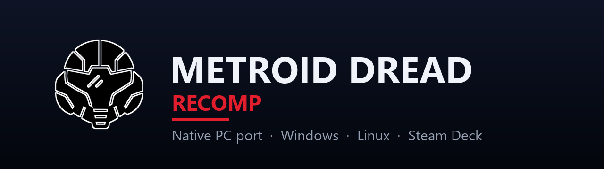
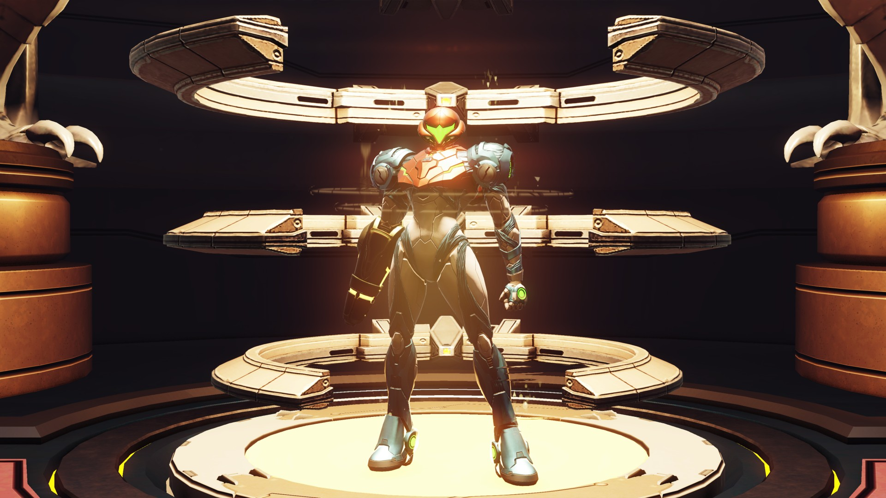

<!-- DRAFT for yozander2009-stack/Metroid-Dread-Recomp. Banner: docs/images/banner.png (own art only, no Nintendo assets). -->

  <a href="https://github.com/yozander2009-stack/Metroid-Dread-Recomp/releases/latest"><b>Download</b></a> ·
  <a href="#get-started">Get started</a> ·
  <a href="docs/ROADMAP.md">Road to 1.0</a> ·
  <a href="docs/FAQ.md">FAQ</a> ·
  <a href="https://github.com/yozander2009-stack/Metroid-Dread-Recomp/issues">Issues</a> ·
  <a href="CHANGELOG.md">Changelog</a>

  
  
  
  

**Metroid Dread Recomp** is a static recompilation of *Metroid Dread* (Nintendo Switch, version 2.1.0) into a native
application for Windows and Linux, built on your PC from your own copy of the game. No emulator: the game code is
translated from ARM64 to C once, compiled by a bundled compiler, and runs directly on your CPU.

Taken in Metroid Dread Recomp at 2.25x resolution with TAA and ambient occlusion. The game is © Nintendo; you need your own copy to run it.

<!-- Video: replace VIDEO_ID with the YouTube video's id, then remove this comment's markers.

-->

> [!IMPORTANT]
> **No game files are included.** You need your own copy of Metroid Dread, updated to **version 2.1.0** and dumped
> from **your own** Nintendo Switch. This project provides no game files, keys, firmware, dumping or decryption tools,
> and no instructions for obtaining them. The game code is recompiled locally, on your machine, from your files.

> [!NOTE]
> **Made with AI.** Most of the runtime fixes, performance work, launcher, setup and tooling were written by Claude
> (Anthropic, through Claude Code), directed, tested and reviewed by a human. Every change is built and measured on
> real hardware before release. The full source is here to read and build.

> [!WARNING]
> **Pre-1.0.** The whole game can be played from start to end, but expect rough edges on hardware that hasn't been
> tested yet. On AMD graphics cards, use **Native Vulkan** (the default there): AMD's OpenGL driver can crash.
> Read the [FAQ](docs/FAQ.md) before opening an issue.

## Features

- The whole game, from your own 2.1.0 copy, on Windows and Linux (Steam Deck included)
- Frame rates of 60, 90, 120, 144, 240 or unlimited, with cutscenes and loading screens at your frame rate
- Resolution scaling, 16:10, 21:9 and 32:9 with a wider view (Hor+) instead of a stretched one
- Two renderers: OpenGL and Native Vulkan
- TAA, FXAA, NVIDIA DLAA (RTX, downloaded from NVIDIA when you ask for it), sharpening, anisotropic filtering up to
  16x, XeGTAO ambient occlusion, higher shadow resolution, HDR (experimental)
- Any controller through SDL2, keyboard remapping, mouse aim, rumble and HD rumble (Switch Pro / Joy-Con, DualSense)
- Xbox / PlayStation button prompts (community packs, fetched on request)
- Skip any cutscene, built-in cheats and Atmosphere cheat files, virtual amiibo
- Mods and texture packs (LayeredFS layout), 5.1 audio, Brazilian Portuguese fan translation
- AUTO-SET picks settings for your PC; one-click updates with undo; Add to Steam
- One button to make a bug report with your logs and system info

## Get started

**You need:** your own Metroid Dread 2.1.0 dump (ExeFS **and** RomFS), Windows 10 or later or Linux on x86-64
(glibc 2.38+), a GPU with OpenGL 4.3 or Vulkan, and 8 GB of RAM.

1. Download the latest build from [Releases](https://github.com/yozander2009-stack/Metroid-Dread-Recomp/releases/latest):
   - **Windows:** the `.zip`. Extract it to a folder you can write to (not Program Files).
   - **Linux and Steam Deck:** `Metroid_Dread-x86_64.AppImage`. Make it executable and run it
     ([Linux and Steam Deck](docs/linux.md)).
2. Start it and choose the folder with your dump (ExeFS: `main`, `main.npdm`, ...; RomFS: `system`, `packs`, ...).
   If the 2.1.0 update is a separate dump, choose it as the update folder. Every file is checked against the 2.1.0
   file list, then the game code is compiled once (a few minutes). Your own files aren't changed.
3. Press **AUTO-SET** if you're not sure about settings, then **PLAY**. **F1** or the Home / Guide button opens the
   in-game menu.

**Updating:** the Play screen offers **UPDATE** when a new release is out. Only changed files are downloaded and checked
before anything is replaced; **UNDO** goes back. Saves, settings and mods are never touched.

## Saves

- **Windows:** `Metroid Dread_data\save` next to `Metroid Dread.exe`
- **Linux / Steam Deck:** `~/.local/share/MetroidDreadRecomp/Metroid Dread_data/save`

Close the game and copy the whole folder to back it up.

## Controls

Any controller SDL2 knows works. Keyboard defaults (Switch button → key):

| Button | Key | Button | Key |
|---|---|---|---|
| Left stick | W A S D | Right stick | I J K L |
| A | X or Space | B | Z |
| X | C | Y | V |
| L / R | Q / E | ZL / ZR | 1 / 3 |
| L3 / R3 | Left Shift / F | + / − | Enter / Backspace |
| D-pad | Arrow keys | Menu | F1 or Esc |

Every key can be rebound on the Play screen (Controls > Keyboard).

## Road to 1.0

0.x builds are previews. Windows and Linux get finished first; **0.9** brings Android and macOS; **1.0** is the first
release meant to be solid everywhere: no known crash, locked frame rates, every scripted moment right above 60 FPS,
and the experimental options finished. Left to do, by area:

| Area | Left for 1.0 |
|---|---|
| Performance | locked 120 in the heaviest effect scenes, shorter hitches on video starts and first room entries |
| Stability | AMD OpenGL driver crash, a few crashes in specific places |
| High frame rates | slow-motion sequences, cutscene audio sync, quick-time events |
| Graphics | Intel / Mesa glitches, HDR out of experimental |
| Controls | Switch 2 Pro Controller on Linux |
| Steam Deck | Game Mode fully checked, TAA / AO cost |
| 0.9 | Android and macOS ports |

Every item, with its issue: [Road to 1.0](docs/ROADMAP.md).

## Found a bug?

Use the latest release, check the [FAQ](docs/FAQ.md) and the [existing issues](https://github.com/yozander2009-stack/Metroid-Dread-Recomp/issues?q=is%3Aissue),
then press **REPORT** on the Play screen: it zips your logs, settings and system info and opens a prefilled issue.
Attach that zip.

## Building from source

See [Building on Windows](docs/BUILD-windows.md) and [Building on Linux](docs/linux.md). Pull requests are welcome:
[CONTRIBUTING.md](CONTRIBUTING.md).

## Respect copyright

- *Metroid Dread* is © Nintendo. This is a fan project, not affiliated with, endorsed or sponsored by Nintendo.
- This repository contains no game files, no game code (also not the C the recompiler generates from it), no assets
  and no keys, and release builds don't either. `dread/dread_v210_patches.json` holds only this project's own edits;
  `dread/romfs_v210.manifest` holds file names, sizes and hashes used to check your dump.
- The code you generate and the build made from it contain Nintendo's code: for your own use only. Don't share or
  upload them.
- Issues or pull requests with game files, keys, generated code or links to pirated copies are removed.

## Credits and licenses

Built on **SwitchRecomp** by MZ Labs (Apache-2.0) with the **ScarletNX** Vulkan renderer (GPL-3.0), Dear ImGui (MIT),
Intel XeGTAO (MIT), a Ryujinx reverb port (MIT), libvpx and OpenH264 (BSD), SDL2 and zlib. Brazilian Portuguese
translation by JumpmanClub Brasil; button-icon packs by Krydar, Nova77 and xSeRosiSx. Full list:
[Credits](docs/third-party.md).

The released program is under **GPL-3.0** because it contains ScarletNX; each source file keeps its own license.
NVIDIA's DLSS file is never in this repository or the release. See [DLSS.md](DLSS.md).
